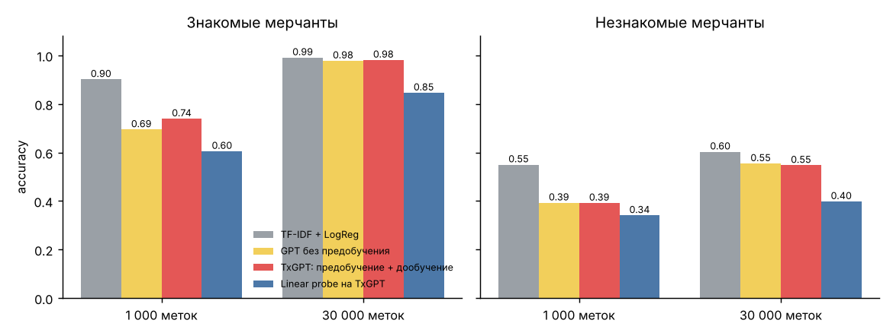

# TxGPT

[](https://github.com/antonshkelll/txgpt-llm-from-scratch/actions/workflows/ci.yml)  

Небольшая языковая модель архитектуры GPT, написанная с нуля на PyTorch: свой BPE-токенизатор, self-attention, предобучение на неразмеченных описаниях банковских операций и дообучение на задачу «описание → категория траты». Модель сравнивается с классическим бейзлайном, чтобы ответить на продуктовый вопрос: когда языковая модель действительно нужна, а когда нет.

<p align="center"></p>

## Зачем

В выписке у оплат по **СБП/QR**, переводов самозанятым и части онлайн-платежей часто **нет MCC-кода** или он неинформативен. Категорию траты («Кафе», «Такси», «Аптеки») банку приходится определять по тексту описания: `ВКУСНО И ТОЧКА 0453 МОСКВА`, `Оплата СБП ИП Петров А.В. (барбершоп)`, `YANDEX*GO 7781`.
От категоризации зависят аналитика расходов в приложении, начисление кешбэка по категориям и персональные предложения. Доля СБП-платежей растёт, и с 1 сентября 2026 все банки обязаны поддерживать единый QR-код, так что задача становится только актуальнее.

**Кому нужно:** командам аналитики трат / PFM, кешбэка и персонализации в банках (Т-Банк, Сбер, Альфа, ВТБ, Яндекс Пэй), а также PFM-приложениям.

## Что внутри

```
src/
  data.py        генератор описаний операций: 15 категорий, 167 мерчантов, 4 канала оплаты, шум
  tokenizer.py   BPE с нуля: обучение склеек, кодирование, декодирование
  model.py       GPT: causal self-attention (руками), pre-norm блоки, weight tying, генерация
  train.py       предобучение → дообучение с early stopping → сравнение с TF-IDF
  probe.py       linear probe: насколько полезны представления предобученной модели
  predict.py     демо: категоризация и генерация «выписки»
  baseline_speed.py  замер скорости и размера бейзлайна
```

**Архитектура:** 4 слоя × 4 головы внимания, d_model = 192, контекст 64 токена, словарь BPE 1 200 токенов, **2,02 млн параметров**. Обучение на 4 ядрах CPU занимает ~35 минут, GPU не нужен.

**Классификация через языковую модель:** модель учится продолжать строку `<bos> описание <sep> категория <eos>`. Для новой операции считается `log P(категория | описание)` для всех 15 категорий, выбирается максимальная, а softmax по категориям даёт уверенность.

## Данные и валидация

Реальные выписки — банковская тайна, поэтому [генератор](src/data.py) создаёт строки в форматах разных каналов: POS-терминал латиницей и кириллицей, онлайн (`YANDEX*GO`), СБП/QR, переводы. Плюс шум: опечатки, обрезка, регистр.

- **Знакомые мерчанты** (seen) — бренды, которые встречались в разметке.
- **Незнакомые мерчанты** (unseen) — **25% брендов каждой категории полностью убраны из разметки**. Это главный тест: новые мерчанты появляются каждый день.
- **Предобучение** идёт на 120 000 **неразмеченных** описаний: у банка таких миллионы, а размечена малая часть. В неразмеченный поток попадают все мерчанты, метки оттуда не используются.
- **Early stopping по валидации** (15% от бюджета разметки), тест не трогается до финальной оценки.

## Результаты

**Предобучение работает:** perplexity упала с 1 225 (случайная модель) до **≈7** на описаниях из отложенной выборки. Модель «пишет» правдоподобные строки выписки сама:

```
MAKSIM 47575 KAZAN RUS
BILAYN 14594 NIZHNIY NOVGOROD RUS
ozon 41472 ekaterinburg rus
Оплата СБП АО «Кухня на районе»
ACADEMY БОСОЛ 125 ТВЕРЬ
```

**Категоризация (accuracy на тесте, по 3 000 операций):**

| Модель | 1 000 меток: знакомые | 1 000 меток: незнакомые | 30 000 меток: знакомые | 30 000 меток: незнакомые |
|---|---:|---:|---:|---:|
| TF-IDF (символьные n-граммы) + LogReg | **0,90** | **0,55** | **0,99** | **0,60** |
| GPT без предобучения | 0,69 | 0,39 | 0,98 | 0,55 |
| **TxGPT** (предобучение + дообучение) | 0,74 | 0,39 | 0,98 | 0,55 |
| Linear probe на замороженном TxGPT | 0,60 | 0,34 | 0,85 | 0,40 |
| Linear probe на случайной модели (контроль) | 0,43 | 0,25 | 0,65 | 0,33 |

| Продуктовые метрики (30 000 меток) | TxGPT | TF-IDF + LogReg |
|---|---:|---:|
| Покрытие автокатегоризации при точности ≥ 95%, знакомые мерчанты | 100% | 100% |
| То же, незнакомые мерчанты | 44% | 57% |
| Задержка на CPU, мс на операцию (пачка из 256) | 17,5 | ≈0,05 |
| Параметров | 2,0 млн | 1,25 млн весов |

## Выводы

1. **Предобучение на неразмеченных данных действительно учит полезным представлениям.** Linear probe на предобученной модели даёт +18 п.п. к той же архитектуре со случайными весами (0,60 против 0,43 при 1 000 меток). При дообучении предобучение даёт +4,5 п.п. на знакомых мерчантах.
2. **Но на этой задаче простой бейзлайн лучше и примерно в 300 раз быстрее** (замер в [`src/baseline_speed.py`](src/baseline_speed.py), результат в `reports/baseline_speed.json`). Описания операций короткие и шаблонные, а символьные n-граммы почти идеально ловят «ПЯТЕРОЧКА/PYATEROCHKA». Маленькому трансформеру нужно больше данных, чтобы догнать. **Продуктовое решение:** в прод идёт TF-IDF + LogReg, а LLM имеет смысл, когда данных и модели на порядки больше (или если брать готовую большую модель).
3. **Незнакомые мерчанты — потолок ~60% для всех моделей.** Это ограничение не модели, а информации: по строке `POBEDA 12091 MOSKVA` без знаний о мире не понять, что это авиакомпания. Решение — **данные, а не модель**: для СБП-платежей банк знает юрлицо получателя, а значит его **ОКВЭД** (вид деятельности из ЕГРЮЛ), и это почти готовая категория. Для остального: справочник мерчантов + ручная разметка топа неизвестных по обороту.
4. **Как внедрять:** автокатегоризировать операции с уверенностью выше порога (точность ≥ 95%), остальные отдавать в «Прочее» или очередь разметки. Метрика продукта: доля операций с категорией и доля ручных исправлений категории пользователями.

## Как шла работа

- **v1:** дообучение без валидации, 800 шагов на 1 000 примерах (~50 эпох). Loss упал до 0,001, и модель просто **запомнила** обучающую выборку. Лог: [`reports/train_log_v1_overfit.txt`](reports/train_log_v1_overfit.txt).
- **v2:** early stopping по валидации, меньший learning rate для предобученной модели, реалистичный неразмеченный поток. Результаты выше: [`reports/results.json`](reports/results.json), [`reports/probe_results.json`](reports/probe_results.json), полный лог [`reports/train_log.txt`](reports/train_log.txt).

## Демо

```bash
python src/predict.py "ВКУСНО И ТОЧКА 0453 МОСКВА" "Оплата СБП ИП Петров А.В. (барбершоп)" "YANDEX*GO 7781"
# 'ВКУСНО И ТОЧКА 0453 МОСКВА'            → Фастфуд и доставка (100%)
# 'Оплата СБП ИП Петров А.В. (барбершоп)' → Красота (100%)
# 'YANDEX*GO 7781'                        → Такси (99%)

python src/predict.py --generate 5     # модель сама генерирует строки выписки
```

## Запуск

Нужен Python 3.10+. GPU не нужен. Чтобы не качать гигабайты CUDA, ставьте CPU-сборку PyTorch.

**macOS / Linux**
```bash
git clone https://github.com/antonshkelll/txgpt-llm-from-scratch.git
cd txgpt-llm-from-scratch
python3 -m venv .venv && source .venv/bin/activate
pip install torch --index-url https://download.pytorch.org/whl/cpu   # на macOS достаточно: pip install torch
pip install -r requirements.txt
pytest -q                    # быстрые тесты: токенизатор, causal-маска, обучение на мини-батче
python src/train.py          # ~35 мин на 4 ядрах: токенизатор, предобучение, дообучение, сравнение
python src/probe.py          # ~2 мин: linear probe и гибрид
python src/plot_results.py   # график reports/accuracy.png
```

**Windows (PowerShell)**
```powershell
git clone https://github.com/antonshkelll/txgpt-llm-from-scratch.git
cd txgpt-llm-from-scratch
py -m venv .venv; .venv\Scripts\Activate.ps1
pip install torch --index-url https://download.pytorch.org/whl/cpu
pip install -r requirements.txt
python src/train.py
```

Обученные веса уже лежат в `checkpoints/` (2 файла по ~8 МБ), поэтому демо работает сразу после установки, без 35 минут обучения. `src/train.py` их перезапишет.

## Ограничения

- Данные синтетические. На реальных выписках разнообразие форматов и шума больше, и именно там предобучение на миллионах строк должно давать больший эффект. Это стоит проверить первым делом.
- Модель маленькая (2 млн параметров) и обучена на CPU. Масштабирование (больше слоёв и данных) — следующий шаг, если появится GPU.

## Стек

PyTorch (свой трансформер, без HuggingFace) · BPE с нуля · scikit-learn (бейзлайн, linear probe) · NumPy · matplotlib

## Связанные проекты

- [Экономика быстрого платежа](https://github.com/antonshkelll/sbp-economics) — почему у СБП-платежей нет MCC и растёт их доля
- [finpilot](https://github.com/antonshkelll/finpilot-mcp) — аналитика выписки для AI-ассистентов

Все проекты — в [профиле](https://github.com/antonshkelll).
